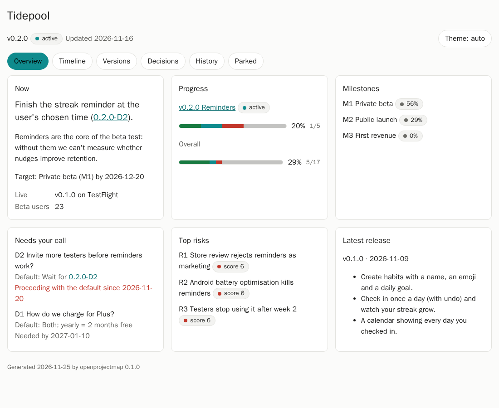
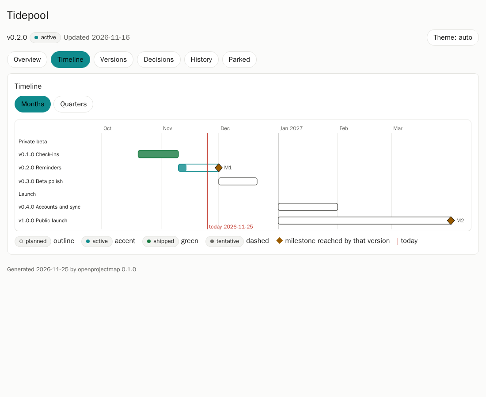

# OpenProjectMap

**Turn your project's markdown docs into a living project map: one HTML file that shows where you
are, what's next, and what needs your decision.**

> Status: alpha (v0.2.0). The parser, `init`, `check`, `build` and `doctor` work, and the map has six
> views. Not on npm yet: the first publish is planned for November 2026. See
> [docs/project/ROADMAP.md](docs/project/ROADMAP.md) for what is next.

OpenProjectMap is for founders, solo builders and "vibe coders" who ship with AI agents and lose
track of the plan. You keep three plain markdown files in your repo:

| File | Holds |
| --- | --- |
| `docs/project/ROADMAP.md` | Where you are now, your versions and what's in each one, milestones, the things you're *not* doing |
| `docs/project/DECISIONS.md` | Questions waiting for your decision (each with a default) and your top risks |
| `CHANGELOG.md` | What you shipped, and when |

Then you run one command:

```bash
npx openprojectmap build      # writes .opmap/index.html
```

You get a single self-contained page with an overview, a timeline, version progress, a
"Needs your call" panel, risks and release history. It works offline, makes no network requests,
and you can open it locally or publish it as a static file.





*The fictional Tidepool example, built with `opmap init --example`.*

## Why markdown, not an app?

- **Your docs are the database.** They live in git next to your code, your AI agent can read and
  update them, and there is no account or lock-in.
- **Agents keep it fresh.** The bundled agent skill teaches Claude Code, Cursor or Codex to read the
  roadmap at the start of a session and update it at the end.
- **It teaches the basics.** If you've never planned versions, milestones or decisions, the
  [Founder Handbook](docs/guide/README.md) walks you through it in plain language, and
  `npx openprojectmap init` interviews you and writes your first roadmap.

## Quick start

```bash
npx openprojectmap init --example   # try it: writes a fictional finished project, then build it
npx openprojectmap init             # your own: asks a few questions, writes the docs and opmap.config.json
npx openprojectmap init --agents claude,cursor,codex   # also teach your AI agents the routine
npx openprojectmap check            # lists problems with file:line and how to fix them
npx openprojectmap build --open     # builds .opmap/index.html and opens it
npx openprojectmap doctor           # checks your setup and says how to fix what is wrong
```

`serve` (a live preview while you edit) and commands that edit the docs for you come in v0.4.

## Principles

- One output file, zero runtime dependencies, no telemetry, no network access (except reading your
  local git history).
- Text from your docs is never treated as HTML, so a map built from a pull request can't run scripts.
- The format is small and documented: [docs/spec/02-doc-format.md](docs/spec/02-doc-format.md).

## Documentation

- [Founder Handbook](docs/guide/README.md): how to plan a project, explained for people who've never done it
- [Doc format v1](docs/spec/02-doc-format.md): exactly what the tool reads
- [Architecture](docs/spec/01-architecture.md) · [CLI](docs/spec/04-cli.md) · [Security](docs/spec/07-security.md)
- [Contributing](CONTRIBUTING.md)

## Licence

AGPL-3.0-only. See [LICENSE](LICENSE). Versions up to and including 0.2.0 on npm were published under MIT.
